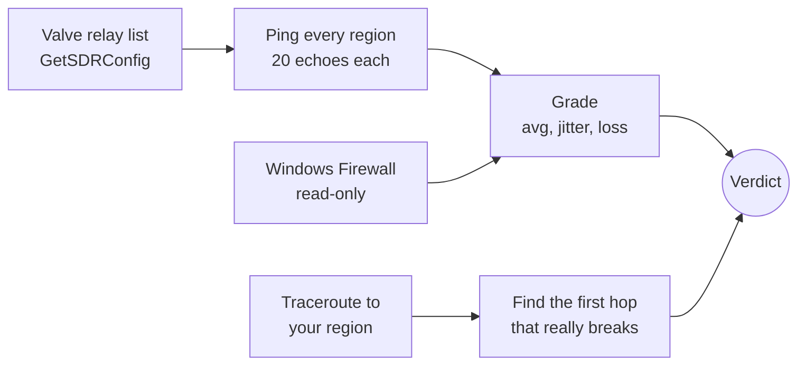

<div align="center">

<picture>
  <source media="(prefers-color-scheme: dark)" srcset="docs/assets/wordmark-dark.png">
  
</picture>

### Know your Counter-Strike 2 connection before you queue.

Netcheck pings every Valve server region, measures jitter and packet loss, and
traces your route to show whether a bad night is your Wi-Fi, your ISP, the
international link, or Valve. Then it launches the game.

[](https://github.com/Mahan-Imanian/netcheck/actions/workflows/ci.yml)
[](https://github.com/Mahan-Imanian/netcheck/releases)
[](LICENSE)


[**Download**](https://github.com/Mahan-Imanian/netcheck/releases/latest) ·
[How it works](docs/how-it-works.md) ·
[Contributing](CONTRIBUTING.md) ·
[Changelog](CHANGELOG.md)


<sub>Recorded from the release build on a live connection, at real speed.</sub>

</div>

## Why Netcheck

Your ping to a CS2 region isn't fixed. It changes with the time of day, your
ISP's international links, and Wi-Fi interference. You usually find out
mid-match, from rubber-banding and lost duels.

Region pickers like Steam Route Tool block servers. Netcheck answers the
question before that: **how is my connection right now, and whose fault is
it?** It doesn't change anything on your PC. It measures, explains, and gets
out of the way.

## Features

- **Every Valve region in about 10 seconds.** Netcheck pings every region,
  using the relay list straight from Valve's API, and reports average,
  worst-5%, jitter and packet loss for each.
- **A verdict you can act on.** "Vienna is unstable right now. Frankfurt is
  5 ms behind and clean." Grades from Excellent to Bad use thresholds you can
  change.
- **Finds the broken hop.** A parallel traceroute groups hops into router, ISP,
  international link and Valve, and names the first one where latency or loss
  really breaks. It learns each hop's normal latency, so plain distance isn't
  mistaken for congestion.
- **Understands your firewall.** If you block regions with Windows Firewall
  rules, Netcheck labels those regions as blocked instead of dead, estimates
  their ping, and warns when a rule does nothing because the firewall is off.
- **History.** A 14-day, hour-by-hour heatmap shows when your preferred region
  is reliably good, plus your best and worst hours.
- **One click to play.** Launch CS2 through Steam, and optionally close
  Netcheck on the way out.
- **Light on your system.** It only runs while its window is open: no tray
  icon, service, autostart or updater. It never needs admin rights and never
  touches the game.

## Screenshots

| Route diagnosis | Every region |
|---|---|
|  |  |
| **History** | **Light theme** |
|  |  |

<sub>The animation above is the real app on a live connection. These four come
from the built-in demo backend, which replays synthetic results and marks every
screen <b>DEV DEMO DATA</b>. Real IPs never appear in them.</sub>

## Install

1. Download the latest installer from
   [**Releases**](https://github.com/Mahan-Imanian/netcheck/releases/latest):
   - `Netcheck_<version>_x64-setup.exe` installs for your user, with no admin
     rights needed. Most people want this one.
   - `Netcheck_<version>_x64_en-US.msi` installs for all users and asks for
     admin rights.
2. Optionally, check that the download is intact. In PowerShell, in the folder
   you downloaded to:

   ```powershell
   Get-FileHash .\Netcheck_*_x64-setup.exe -Algorithm SHA256
   ```

   The hash should match the line for that file in `SHA256SUMS.txt` on the
   release page.
3. Run the installer, then open Netcheck from the Start menu before you play.

Requirements: Windows 11, 64-bit, with Microsoft Edge WebView2 (built into
Windows 11). Windows 10 should work, because the app and its WebView2 runtime
both support it, but it hasn't been tested yet. If you try it, please
[report how it went](https://github.com/Mahan-Imanian/netcheck/issues/new?template=bug_report.yml).

### About the "Windows protected your PC" warning

The installers aren't code-signed yet. Code signing needs a paid certificate
that ties a file to a verified publisher, and this project doesn't have one
yet. Because of that, Windows SmartScreen will probably show **"Windows
protected your PC"** the first time you run the installer. To continue,
choose **More info**, then **Run anyway**.

What this means for you:

- Windows can't confirm who published the file. Only download Netcheck from
  this repository's [Releases page](https://github.com/Mahan-Imanian/netcheck/releases).
  Copies elsewhere could be modified.
- The installers are built by
  [GitHub Actions](https://github.com/Mahan-Imanian/netcheck/actions/workflows/release.yml)
  from the tagged source in this repository, not on someone's PC, and the
  checksums are generated in the same run.
- Antivirus software is sometimes more suspicious of unsigned programs. If
  yours flags Netcheck, please
  [open an issue](https://github.com/Mahan-Imanian/netcheck/issues) with the
  detection name.
- Once a signing certificate is in place, releases will be signed
  automatically and the warning will go away.

Netcheck itself never asks for administrator rights. The per-user installer
doesn't need them either.

### Known limitations

- **Tested on Windows 11 only.** Windows 10 is expected to work, but hasn't been
  tested.
- **Launch CS2** opens `steam://rungameid/730`, the same link a desktop
  shortcut uses, so Steam needs to be installed. Launching the game, and the
  "close Netcheck after launching" option, haven't been tested end to end yet.
- **Some VPNs and firewalls drop ICMP.** Regions then show "no reply", even
  though the game itself may connect fine.
- **IPv4 only**, matching the relay addresses Valve publishes.

## Using it

1. **Open Netcheck.** The check starts on its own and takes about 10 seconds.
2. **Read the verdict.** The big number is your preferred region (Vienna by
   default; change it in Settings). The line under the gauge says whether it's
   good to play, and suggests a cleaner region if one exists.
3. **If it's bad, open Route.** It shows which section of the path is at fault.
   Your router or Wi-Fi is something you can fix. Congestion on the
   international link usually clears up off-peak.
4. **Press Launch CS2.**

Press <kbd>R</kbd> at any time to check again. **History** shows your best and
worst hours once you've run a few checks.

### Settings

| Setting | What it does |
|---|---|
| Your region | The region the gauge, route trace and history follow. |
| Pings per region | 10 to 100, sent 100 ms apart. More pings give steadier numbers and take longer. |
| Grade thresholds | Average, jitter and loss limits for each grade. Defaults live in [`config/thresholds.json`](config/thresholds.json). |
| After launching CS2 | Close Netcheck, keep it open, or ask each time. |
| Theme | System, dark or light. |
| Map origin | Where the map's arcs start. Auto uses the location of your lowest-ping region. Custom lets you set it. |

## How it works



Netcheck sends ICMP echoes through the Windows `IcmpSendEcho2` API, the same
path `ping.exe` uses. On Windows 11 its averages landed within 3 ms of
`ping -n 20` against the same live Valve relays. The diagnosis only blames a
hop when your region is actually degraded, ignores routers that are just slow
to answer pings themselves, and subtracts each hop's normal latency.

**Network use:** Valve's public relay list, ICMP echoes to relays, your router,
1.1.1.1 and the hops on your route, and nothing else. No telemetry, no
accounts, no update checks.

The full details, with the exact rules, files on disk and architecture, are in
[**docs/how-it-works.md**](docs/how-it-works.md).

## FAQ

<details>
<summary><b>Can this get me VAC banned?</b></summary>

Netcheck doesn't read, inject into or modify CS2, Steam or any game file, and
it doesn't run while you play unless you leave it open. It pings Valve's
public relay servers the same way `ping.exe` does, and launches the game
through a `steam://` link. Netcheck isn't affiliated with or endorsed by Valve.
</details>

<details>
<summary><b>Does it block or pick servers for me?</b></summary>

No. Netcheck only measures. If you already block regions with Windows Firewall,
Netcheck reads those rules and labels the blocked regions. It never changes
firewall rules, routes or system settings.
</details>

<details>
<summary><b>Why does it say a hop is fine when it shows a big number?</b></summary>

Long-distance links add latency through plain physics. Netcheck learns each
hop's normal latency from your history and only calls out rises above that, and
only when your region is actually degraded.
</details>

<details>
<summary><b>Does it work with a VPN?</b></summary>

Netcheck measures the path your traffic actually takes. With a VPN on, that's
the path through the VPN, which is useful for comparing the two. Some VPNs drop
ICMP, and then regions show no reply.
</details>

## Build from source

You need Rust (stable), Node.js 22+, pnpm 10 and a Windows C toolchain. See
[CONTRIBUTING.md](CONTRIBUTING.md#development-setup) for details.

```bash
git clone https://github.com/Mahan-Imanian/netcheck.git
```

```bash
cd netcheck
```

```bash
pnpm install
```

```bash
pnpm tauri dev
```

`pnpm tauri build` produces both installers in `target/release/bundle/`. To
work on the UI on any OS, run `pnpm dev:demo` and open
<http://localhost:1420/?scenario=unstable>.

## Roadmap

These are plans, not promises. Ideas and pull requests are welcome in
[issues](https://github.com/Mahan-Imanian/netcheck/issues).

- [ ] Signed installers, so SmartScreen stops warning
- [ ] Tested Windows 10 support
- [ ] Install with `winget` and Scoop
- [ ] Other Steam Datagram Relay games that use the same relay list, such as Dota 2 and Deadlock
- [ ] Translations
- [ ] A portable build that doesn't need installing

## Contributing

Bug reports from real networks are the most useful contribution, because every
ISP behaves differently. Read [CONTRIBUTING.md](CONTRIBUTING.md) to set up the
project, run the checks and open a pull request. Everyone taking part follows
the [Code of Conduct](CODE_OF_CONDUCT.md).

## Security

Please report vulnerabilities privately through
[GitHub security advisories](https://github.com/Mahan-Imanian/netcheck/security/advisories/new),
not as public issues. See [SECURITY.md](SECURITY.md).

## Code signing policy

Netcheck is preparing an application to the SignPath Foundation for free Authenticode code signing. The project has not yet been approved, and no signing certificate has been issued. Until signing is enabled, Windows installers remain unsigned.

If accepted, release signing will be performed through SignPath's GitHub Actions integration. Only release artifacts built from tagged source in this repository may be submitted for signing. Each signed installer must have its Authenticode signature verified before publication. Signing credentials and private keys must never be committed to this repository.

## License and acknowledgements

Netcheck is released under the [MIT License](LICENSE).

It's built with [Tauri](https://tauri.app), [React](https://react.dev),
[Motion](https://motion.dev) and [Tailwind CSS](https://tailwindcss.com). The
world map is drawn from [Natural Earth](https://www.naturalearthdata.com) data
via [world-atlas](https://github.com/topojson/world-atlas). Flags come from
[country-flag-icons](https://www.npmjs.com/package/country-flag-icons) and
icons from [Lucide](https://lucide.dev). Type is set in
[Geist](https://vercel.com/font) and
[Barlow Condensed](https://github.com/jpt/barlow). Relay data comes from Valve's
public Steam Web API.

Counter-Strike, Counter-Strike 2 and Steam are trademarks of Valve Corporation.
Netcheck is an independent project, not affiliated with or endorsed by Valve.
