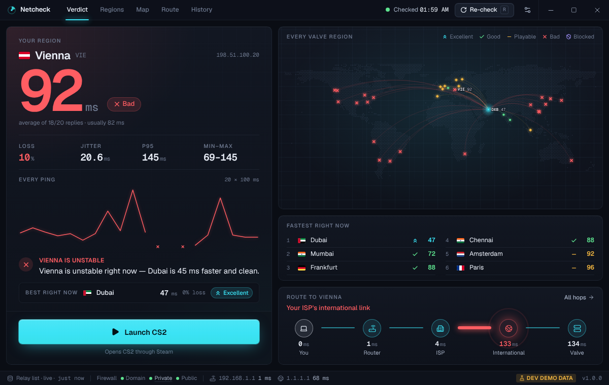
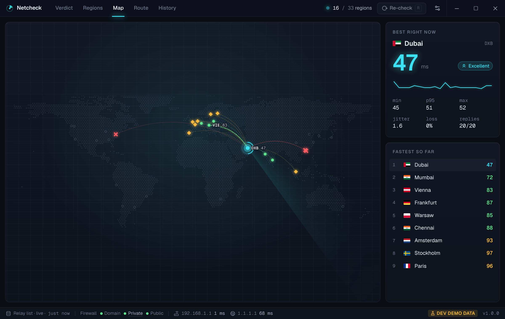
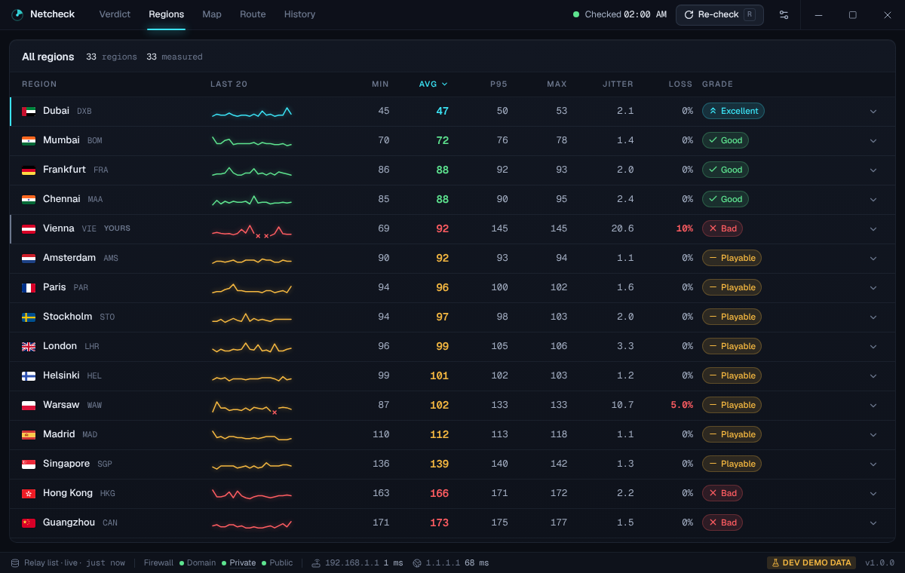
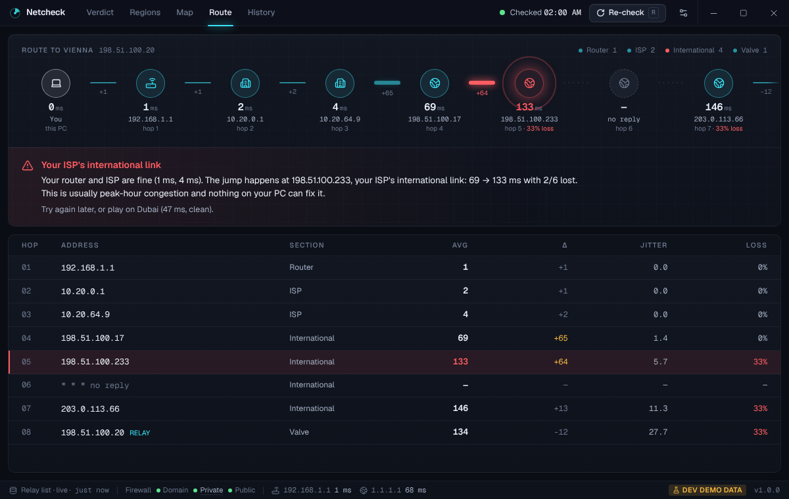
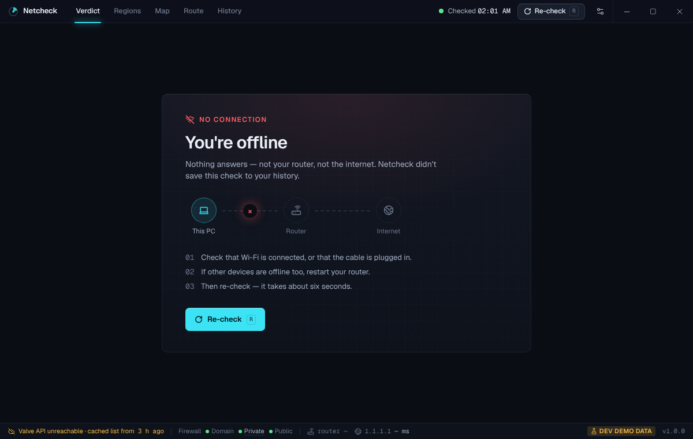
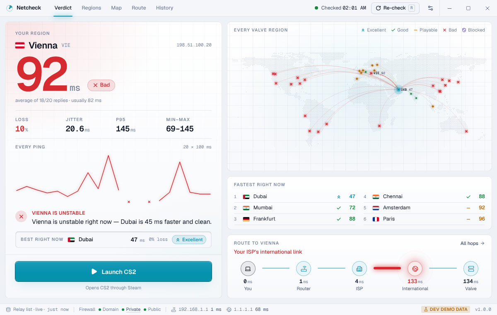

# Netcheck

A pre-match connection check for Counter-Strike 2 on Windows. Open it before
you queue. Within a few seconds it shows your ping, jitter and packet loss to
every Valve relay region, where on the route any problem starts, and a
**Launch CS2** button.

Netcheck runs only while its window is open. It has no tray icon, service,
autostart, updater or game watcher. Closing the window cancels every probe in
flight, flushes the history database and ends the process.

## Build

Requirements: Rust (stable), Node 22, pnpm 10. Windows builds need the MSVC
toolchain and WebView2. The MSI also needs WiX, which the Tauri CLI fetches.

```bash
pnpm install
```

```bash
pnpm tauri dev
```

```bash
pnpm tauri build
```

`pnpm tauri build` produces `target/release/bundle/msi/*.msi` and
`target/release/bundle/nsis/*-setup.exe`. The NSIS installer is per-user, so it
installs without admin rights. The MSI is per-machine and Windows asks for
elevation to install it. The app itself never elevates: its manifest says
`asInvoker`.

Signing: `.github/workflows/release.yml` imports a PFX from the
`WINDOWS_CERTIFICATE` / `WINDOWS_CERTIFICATE_PASSWORD` secrets and passes its
thumbprint to the Tauri bundler. Without those secrets the installers are built
unsigned.

### Tests

```bash
cargo test -p netcheck-core
```

```bash
pnpm test
```

```bash
pnpm typecheck
```

The Rust tests cover stats (jitter, p95, grading), problem-hop detection with a
fixture route for each of the four cases, blocked-region detection, the relay
list cache, the history store and the check engine (with a scripted prober).
`crates/netcheck-core/tests/icmp_loopback.rs` pings 127.0.0.1 through the real
`IcmpSendEcho2` path. It only compiles on Windows and runs in CI on
`windows-latest`.

`cargo test` also regenerates the TypeScript types in `src/bindings/` from the
Rust structs (ts-rs), so the frontend and backend can't drift apart.

### Demo mode (development only)

```bash
pnpm dev:demo
```

Then open `http://127.0.0.1:1420/?scenario=unstable`. Scenarios: `normal`,
`unstable`, `congested`, `wifi`, `offline`, `blocked`, `allblocked`,
`firewalloff`, `cache`, `norelays`, `longroute`. Add `&theme=light` or
`&speed=0.5` as needed.

Demo data is synthetic, uses only RFC 5737 documentation IPs, and shows a
**DEV DEMO DATA** badge. It is only compiled in when `VITE_NETCHECK_DEMO=1`, and
CI checks that the shipped bundle doesn't contain it.

## Network use

Netcheck makes exactly these requests, and nothing else:

1. `GET https://api.steampowered.com/ISteamApps/GetSDRConfig/v1/?appid=730`, for
   Valve's relay list. The last good response is cached in
   `%APPDATA%\app.netcheck.desktop\sdr-config.json`. A cache under 12 hours old
   is used immediately and refreshed in parallel with the pings. If Valve is
   unreachable, any older cache is used and its age is shown.
2. ICMP echo to relay IPs, your default gateway, 1.1.1.1, and each hop on the
   route.
3. TTL-limited ICMP echo for the traceroute.

Fonts (Geist, Geist Mono), icons, flags and the world map are bundled. The CSP
allows no remote origins. Relay IPs are never hardcoded.

## How the measurements work

**Per region.** Netcheck sends one quick echo to each relay in turn (up to
four) and uses the first that answers. It then sends 20 echoes (configurable,
10–100) at 100 ms intervals with a 1 s timeout and a 32-byte payload, the same
as `ping.exe`. Sends don't wait for replies, so a 180 ms RTT doesn't stretch the
100 ms interval. Up to 16 regions are measured at once, and your preferred
region always goes first. A full check takes about 6–8 s.

| Stat | Definition |
|---|---|
| min / avg / max | over the echoes that were answered |
| p95 | nearest-rank 95th percentile |
| jitter | mean absolute difference between consecutive answered RTTs |
| loss | lost ÷ sent |

**Grades.** Thresholds live in `config/thresholds.json` and can be changed in
Settings. A region gets the best grade whose every limit it meets: average,
jitter and loss.

| Grade | Avg | Jitter | Loss | Meaning |
|---|---|---|---|---|
| Excellent | ≤ 50 ms | ≤ 4 ms | 0 % | Nothing to notice. |
| Good | ≤ 90 ms | ≤ 10 ms | ≤ 2 % | Fine for competitive play. |
| Playable | ≤ 150 ms | ≤ 25 ms | ≤ 5 % | You'll feel it in duels: peeker's advantage, occasional rubber-banding. |
| Bad | anything worse | | | Expect lost shots and teleporting players. |

Colour is always paired with an icon and a label (»  ✓  –  ✕), so the grades
read without colour vision.

**Blocked regions.** Netcheck reads Windows Firewall through `INetFwPolicy2`
(read-only). A region is **Blocked by your firewall** when every relay sits in
an enabled, outbound block rule that applies to CS2: no program set, or
`cs2.exe`. The rule must also be enforced by a profile that is both switched on
and active on your current network. For blocked regions Netcheck pings unblocked
neighbours in the same /24 (relay ±1…±3) and labels the number **estimated**.
If a block rule exists but the firewall is off for your network, Netcheck warns
that the block does nothing.

**Where's the problem.** Netcheck traces the route to your preferred region:
TTL 1–15 are probed in parallel. Each hop that answers then gets 6 echoes. Hops
are grouped into sections:

- **Router**: TTL 1.
- **ISP**: TTL 2–3, plus later private or CGNAT addresses.
- **International**: everything after the ISP except the last hop.
- **Valve**: the relay itself.

The problem hop is the first where latency jumps more than 25 ms over the
previous answering hop, or loss passes 5 %. Three corrections stop it from
crying wolf:

- **Nothing is blamed while your region is healthy.** No hop is reported unless
  the destination itself is degraded.
- **Spikes must carry through.** Routers deprioritise ICMP addressed to
  themselves. A spike only counts if every later hop keeps it, and loss only
  counts if the destination keeps it.
- **Distance isn't congestion.** Each hop's lowest average in the last 30 days
  is its "normal", and the rise it normally adds is subtracted. Until that
  history exists, a perfectly stable rise on the international segment counts
  as long-haul propagation, not a problem. (Tehran → Europe adds ~65 ms of
  plain distance every night.)

1.1.1.1 is measured as an "is the whole internet slow?" baseline. If 1.1.1.1 is
bad and most regions are degraded, the verdict blames your ISP, not any one
region.

**History.** Every online check is saved to
`%APPDATA%\app.netcheck.desktop\history.sqlite3` (SQLite, WAL) and kept for 30
days. The History screen shows your preferred region by hour of day over the
last 14 days, plus the best and worst hours.

## Architecture

```
crates/netcheck-core/      platform logic, testable on any OS
  icmp.rs        IcmpSendEcho2 behind a Prober trait; timed echo series
  traceroute.rs  parallel TTL discovery + per-hop measurement
  sdr.rs         Valve relay list: fetch, parse, disk cache
  firewall.rs    INetFwPolicy2 reader (read-only) + pure block classification
  store.rs       SQLite history, settings, retention
  stats.rs       min/avg/p95/max/jitter/loss, grading
  diagnosis.rs   route sections + problem-hop detection
  check.rs       orchestration, one CancellationToken, streamed events
  netinfo.rs     default gateway (GetIpForwardTable2)
src-tauri/                 Tauri shell: commands, window lifecycle, shutdown
src/                       React + TypeScript UI, one Zustand store
```

The app never modifies firewall rules, routes or any system setting.

## Verification status

What has been verified, and how:

- **Verified on Linux:** 45 Rust unit tests and 10 frontend tests. Strict
  `tsc`. Clippy with `-D warnings` on the Windows target. The Windows code
  type-checks, and a release `netcheck.exe` plus an NSIS installer
  cross-compile with mingw. The exe imports `IcmpSendEcho2`,
  `GetIpForwardTable2` and `CoCreateInstance`, and its manifest says
  `asInvoker`. Every screen was screenshotted at 960×620, 1200×760 and
  1920×1080, in both themes and with reduced motion, using the demo backend.
- **Needs a Windows machine:** run `scripts/verify-windows.ps1 -Relay <ip>`.
  It compares Netcheck's ICMP path with `ping -n 20` (target ±3 ms) and checks
  that no `netcheck` process survives closing the window, both mid-check and
  after one. Still to check by hand: Launch CS2 and close-after-launch, the
  firewall-off warning, blocked/estimated labels with real rules, and unplugging
  the cable.

## Screenshots

These come from the demo backend (synthetic data, marked DEV DEMO DATA).

| | |
|---|---|
|  |  |
|  |  |
|  |  |
