# How Netcheck works

This is the technical reference: what Netcheck measures, how it decides what's
wrong, what it sends over the network, and how the code is put together.

- [The check, step by step](#the-check-step-by-step)
- [Measurements](#measurements)
- [Grades](#grades)
- [Blocked regions](#blocked-regions)
- [Finding the problem on the route](#finding-the-problem-on-the-route)
- [Network use and privacy](#network-use-and-privacy)
- [Updates](#updates)
- [Files on disk](#files-on-disk)
- [Architecture](#architecture)
- [Demo scenarios](#demo-scenarios)
- [Screens and states](#screens-and-states)
- [Building installers and signing](#building-installers-and-signing)

## The check, step by step

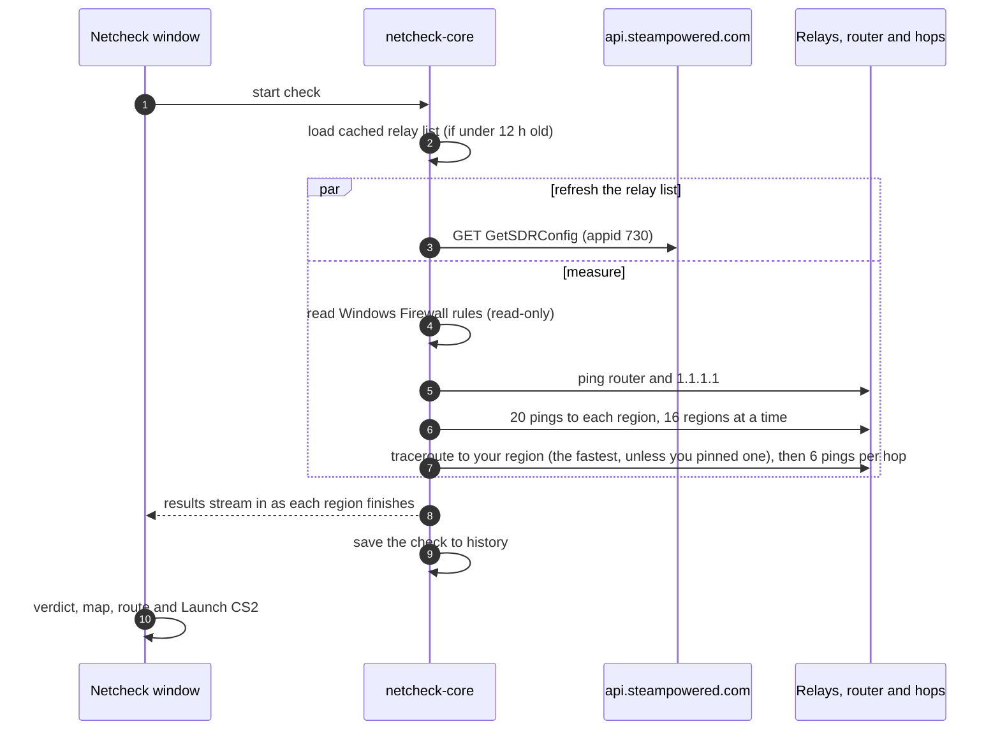

A full check of about 45 regions takes around 10 seconds, depending on your connection. Closing the window cancels every probe
in flight, flushes the history database and ends the process. Netcheck has no
tray icon, service, autostart, background updater or game watcher.

## Measurements

**Per region.** Netcheck sends one quick echo to each relay in turn (up to
four) and uses the first that answers. It then sends 20 echoes (configurable,
10 to 100) at 100 ms intervals with a 1 s timeout and a 32-byte payload, the
same as `ping.exe`. Sends don't wait for replies, so a 180 ms RTT doesn't
stretch the 100 ms interval. Up to 16 regions are measured at once. A region
you pinned in Settings goes first.

**Your region.** By default Netcheck uses the fastest region. It ranks each
region by average ping plus twice its jitter plus eight times its loss
percentage, skipping regions your firewall blocks. The gauge follows the
leader while results arrive, and the route is traced to the winner once every
region has answered. A region pinned in Settings is traced from the start.

| Stat | Definition |
|---|---|
| min / avg / max | over the echoes that were answered |
| p95 ("worst 5%") | nearest-rank 95th percentile |
| jitter | mean absolute difference between consecutive answered RTTs |
| loss | lost ÷ sent |

On Windows 11, 20 echoes through Netcheck's ICMP path landed within 3 ms of
`ping -n 20` against the same live Valve relays.
[`scripts/verify-windows.ps1`](../scripts/verify-windows.ps1) repeats that
comparison on your machine.

## Grades

Thresholds live in [`config/thresholds.json`](../config/thresholds.json) and can
be changed in Settings. A region gets the best grade whose every limit it meets:
average, jitter and loss.

| Grade | Avg | Jitter | Loss | Meaning |
|---|---|---|---|---|
| Excellent | ≤ 50 ms | ≤ 4 ms | 0 % | Nothing to notice. |
| Good | ≤ 90 ms | ≤ 10 ms | ≤ 2 % | Fine for competitive play. |
| Playable | ≤ 150 ms | ≤ 25 ms | ≤ 5 % | You'll feel it in duels: peeker's advantage, occasional rubber-banding. |
| Bad | anything worse | | | Expect lost shots and teleporting players. |

Colour is always paired with a text label and, in most places, an icon, so the
grades read without colour vision.

## Blocked regions

Many players block regions with Windows Firewall rules so CS2 can't use them.
Netcheck reads those rules through `INetFwPolicy2` (read-only) and labels the
regions instead of reporting them as dead.

A region is **Blocked by your firewall** when every relay sits in an enabled,
outbound block rule that applies to CS2: one with no program set, or `cs2.exe`.
The rule must also be enforced by a profile that is both switched on and active
on your current network. Rules limited to another Windows user
(`LocalUserAuthorizedList`) or to a Store app package are ignored, because they
can't affect CS2 run by you.

For blocked regions, Netcheck pings unblocked neighbours in the same /24
(relay ±1 to ±3) and labels the number **estimated**. If a block rule exists
but the firewall is off for your network, Netcheck warns that the block does
nothing.

## Finding the problem on the route

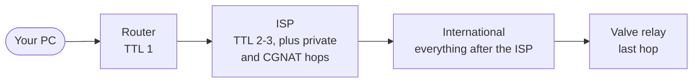

Netcheck traces the route to your region. TTL 1 to 15 are probed in
parallel, so 15 hops take about one timeout, not fifteen. Each hop that answers
then gets 6 echoes.

The problem hop is the first where latency jumps more than 25 ms over the
previous answering hop, or loss passes 5 %. Three rules stop it from crying
wolf:

- **Nothing is blamed while your region is healthy.** No hop is reported unless
  the destination itself is degraded.
- **Spikes must carry through.** Routers deprioritise ICMP addressed to
  themselves. A spike only counts if every later hop keeps it, and loss only
  counts if the destination keeps it.
- **Distance isn't congestion.** Each hop's lowest average in the last 30 days
  is its "normal", and the rise it normally adds is subtracted. Until that
  history exists, a perfectly stable rise on the international segment counts
  as long-haul propagation, not a problem. A long international route can add
  60 ms or more of plain distance, every night, without anything being wrong.

1.1.1.1 is measured as an "is the whole internet slow?" baseline. If 1.1.1.1 is
bad and most regions are degraded, the verdict blames your ISP, not any one
region.

## Network use and privacy

Netcheck makes exactly these requests, and nothing else:

1. `GET https://api.steampowered.com/ISteamApps/GetSDRConfig/v1/?appid=730`,
   for Valve's relay list. A cache under 12 hours old is used immediately and
   refreshed in parallel with the pings. If Valve is unreachable, any older
   cache is used and its age is shown.
2. ICMP echo to relay IPs, your default gateway, 1.1.1.1, and each hop on the
   route.
3. TTL-limited ICMP echo for the traceroute.
4. `GET https://api.github.com/repos/Mahan-Imanian/netcheck/releases/latest`,
   once when the window opens, after the first check finishes. Turn it off in
   Settings under Updates. If you choose Update now, Netcheck also downloads
   the installer from this repository's release page.

There is no telemetry, account or analytics. Fonts, icons, flags
and the world map are bundled, the Content Security Policy allows no remote
origins, and relay IPs are never hardcoded.

Netcheck never modifies firewall rules, routes or any system setting, and never
reads or touches CS2, Steam or game files. **Launch CS2** opens
`steam://rungameid/730`, the same link a desktop shortcut uses.

## Updates

When a newer release is published, Netcheck shows its version and notes and
offers two choices. Later closes the dialog until the next launch. Update now
downloads the installer that matches how Netcheck was installed, checks its
SHA-256 against the digest GitHub publishes for that file, and refuses it if
they differ. Then it starts the installer and closes.

| Installed with | Update now runs |
|---|---|
| The setup `.exe` (a folder with `uninstall.exe`) | The new setup `.exe` in passive mode, which reopens Netcheck when it's done |
| The `.msi` (under Program Files) | `msiexec /i` in passive mode. Windows asks for admin rights. |
| The portable `.exe` | Nothing. The button opens the release page instead. |

Only files from `github.com/Mahan-Imanian/netcheck/releases/download/` are
accepted. The checksum proves the download matches what GitHub has for that
release. Because the files aren't code-signed, it doesn't prove who built them.

## Files on disk

| File | Purpose |
|---|---|
| `%APPDATA%\app.netcheck.desktop\sdr-config.json` | Last good relay list from Valve. |
| `%APPDATA%\app.netcheck.desktop\history.sqlite3` | Every online check, kept for 30 days (SQLite, WAL). |
| `%TEMP%\netcheck-update\` | The last update installer, only if you chose Update now. |

Deleting the folder resets Netcheck's cache, history and settings.

## Architecture

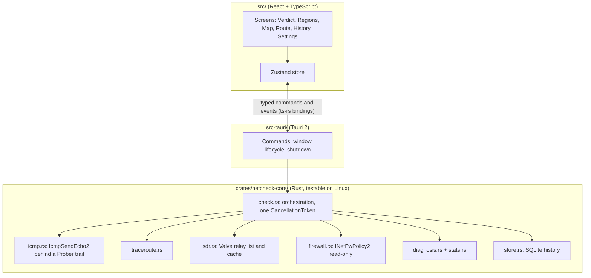

| Module | Responsibility |
|---|---|
| `icmp.rs` | `IcmpSendEcho2` behind a `Prober` trait, plus timed echo series. |
| `traceroute.rs` | Parallel TTL discovery and per-hop measurement. |
| `sdr.rs` | Valve relay list: fetch, parse, disk cache. |
| `firewall.rs` | `INetFwPolicy2` reader (read-only) and pure block classification. |
| `store.rs` | SQLite history, settings, retention. |
| `stats.rs` | min, avg, p95, max, jitter, loss and grading. |
| `diagnosis.rs` | Route sections and problem-hop detection. |
| `check.rs` | Orchestration, cancellation and streamed events. |
| `netinfo.rs` | Default gateway (`GetIpForwardTable2`). |
| `update.rs` | Latest-release check, installer download and checksum. |

The TypeScript types in `src/bindings/` are generated from the Rust structs by
[ts-rs](https://github.com/Aleph-Alpha/ts-rs) during `cargo test`, so the UI and
the core can't drift apart. CI fails if they're out of date.

## Demo scenarios

`pnpm dev:demo` runs the UI against a synthetic backend at
<http://localhost:1420>. Pick a scenario with `?scenario=`:

`normal`, `unstable`, `congested`, `wifi`, `offline`, `blocked`, `allblocked`,
`firewalloff`, `cache`, `norelays`, `longroute`.

Add `&update=1` to show the update dialog, `&update=portable` for the
portable build's version of it, or `&update=fail` to see a failed download.

Add `&theme=light`, `&speed=0.5` or `&tab=regions` (or `map`, `route`,
`history`, `settings`) as needed. Demo data uses only RFC 5737 documentation
IPs and shows a **DEV DEMO DATA** badge. It's only compiled in for `--mode demo`,
and CI checks that release bundles don't contain it.
[`scripts/screenshots.ps1`](../scripts/screenshots.ps1) captures the README
images from these scenarios.

## Screens and states

Every state below comes from the demo backend, which is why each one shows a
**DEV DEMO DATA** badge.

| | |
|---|---|
| 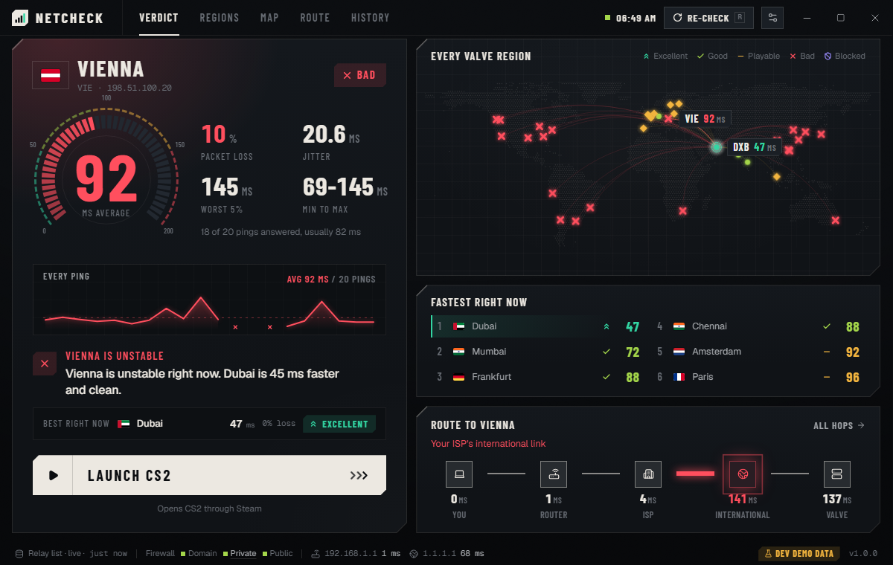 | 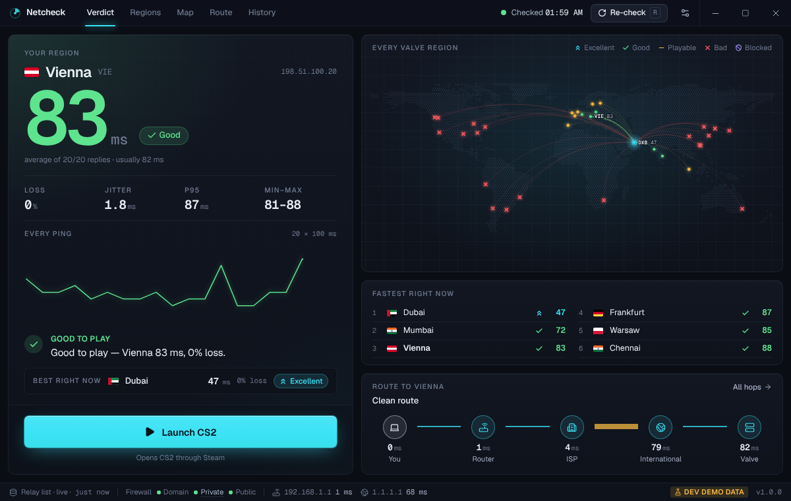 |
| Unstable region, cleaner alternative suggested | Clean check |
| 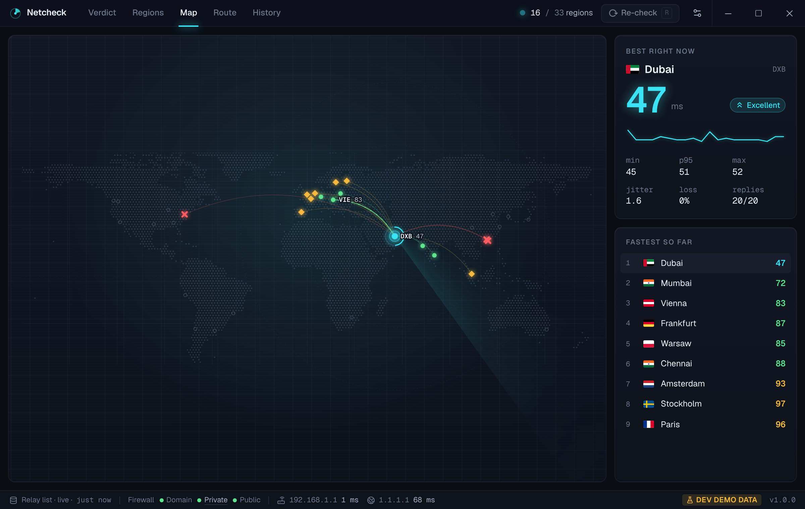 | 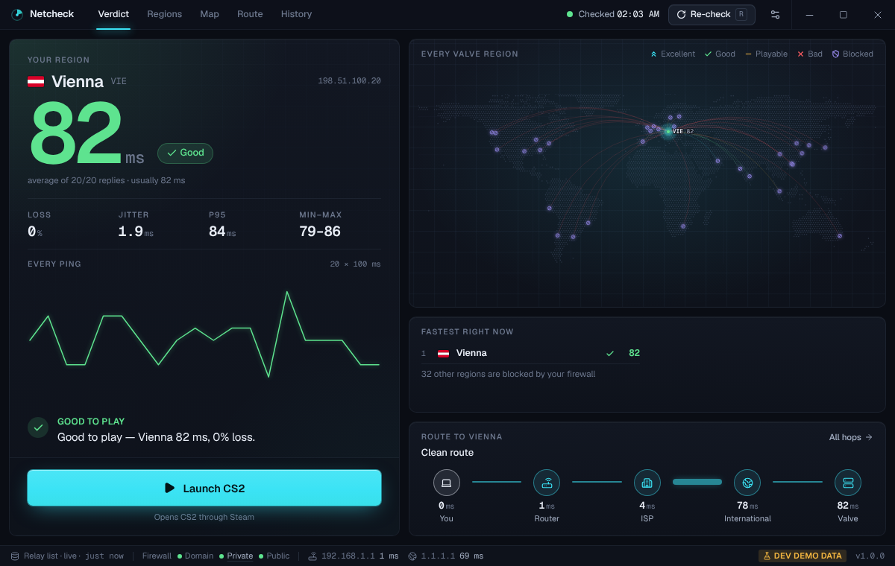 |
| The map while regions arrive | Regions blocked by firewall rules |
| 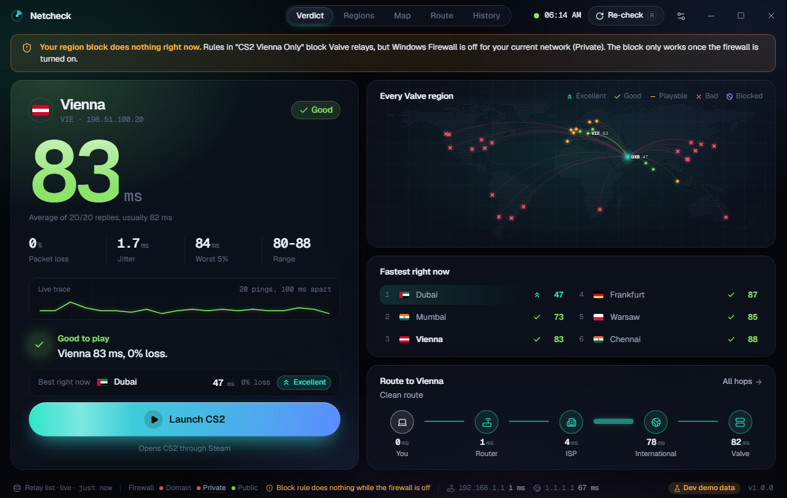 | 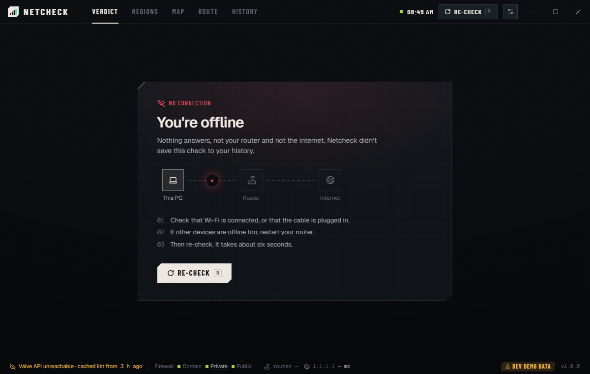 |
| A block rule that does nothing while the firewall is off | Offline |
| 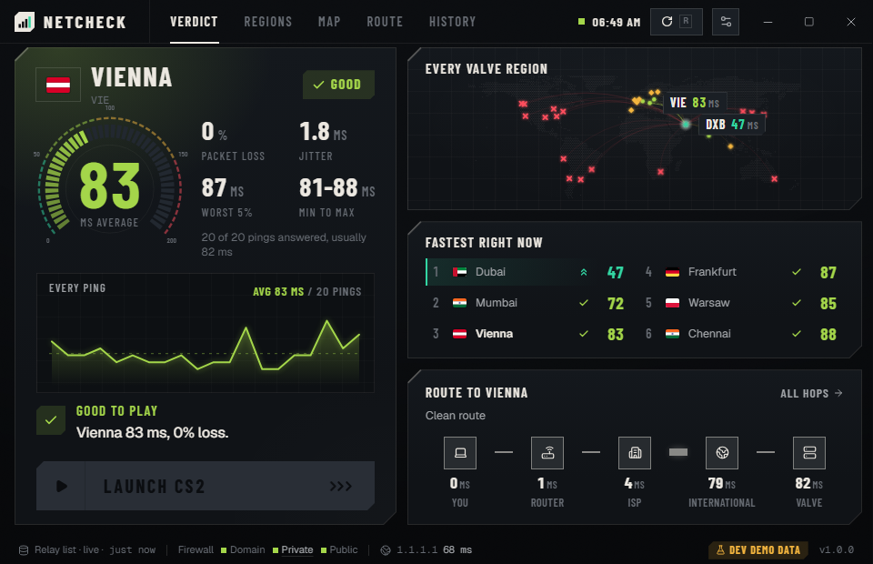 | 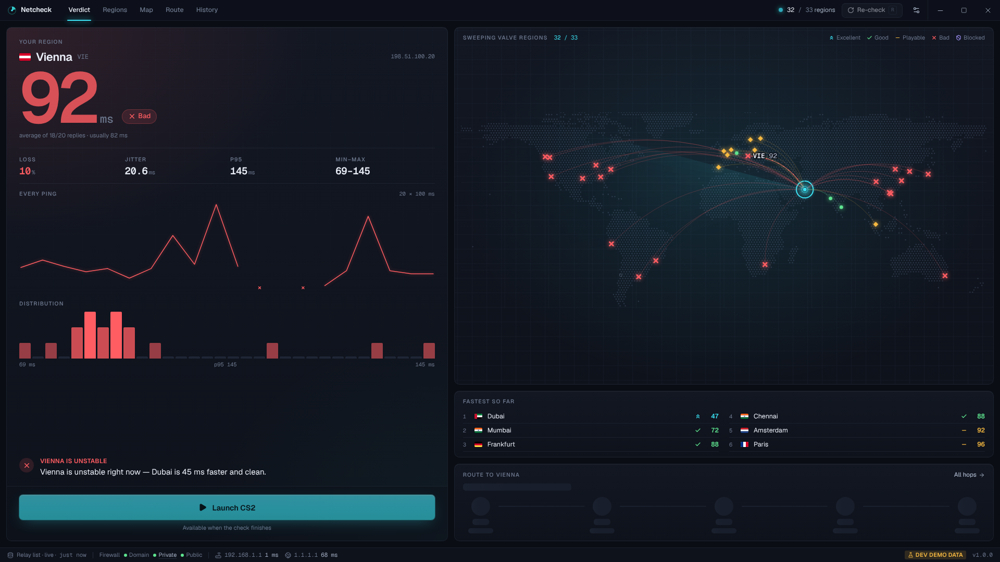 |
| Smallest window, 960 × 620 | 1920 × 1080 |
| 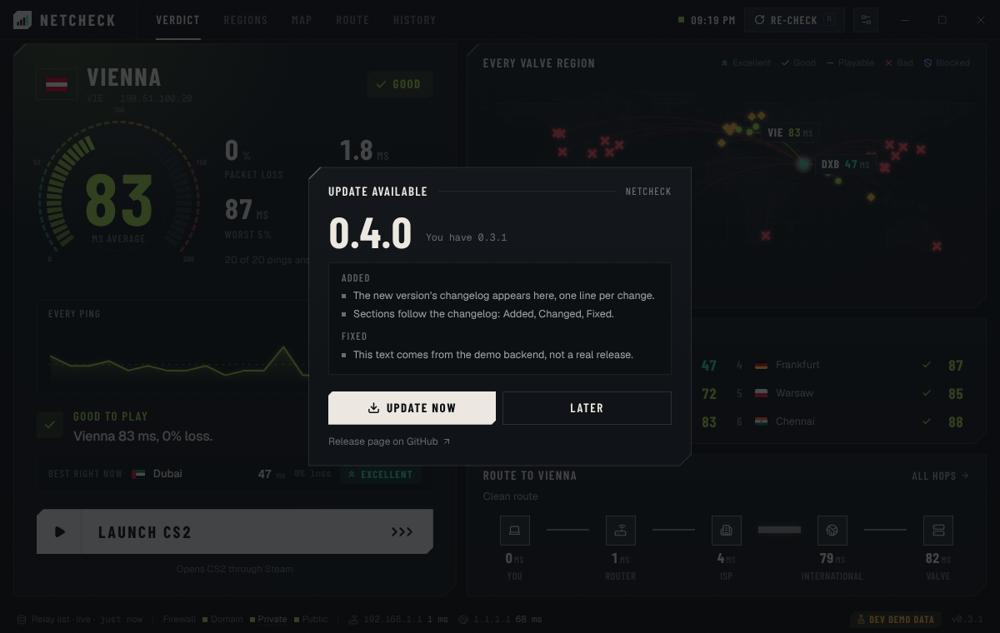 | 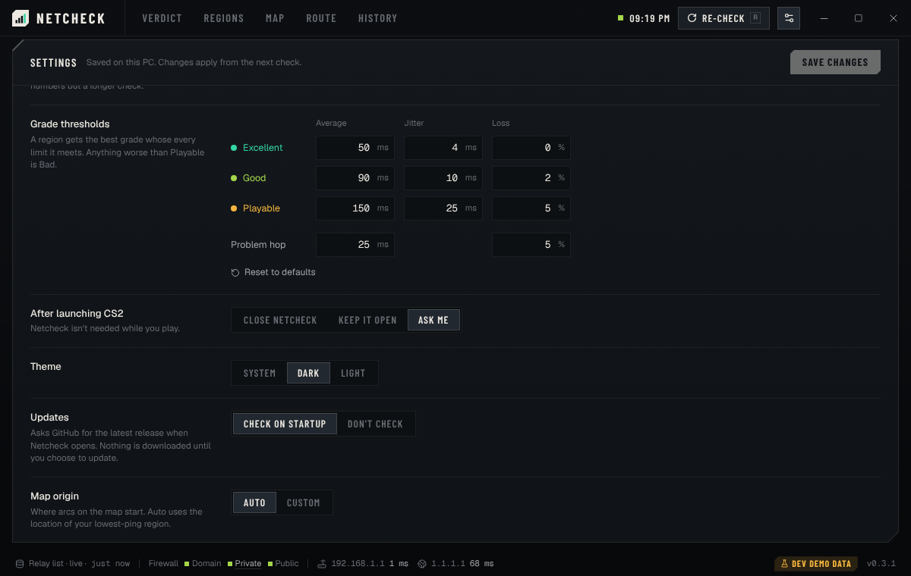 |
| A newer release is out | Settings, including the update check |

## Building installers and signing

The app icon is generated from [`src-tauri/icons/icon.svg`](../src-tauri/icons/icon.svg):

```bash
pnpm tauri icon src-tauri/icons/icon.svg -o src-tauri/icons
```

That command also writes Android and iOS icon folders, which this Windows app
doesn't use. Delete them before committing.

```bash
pnpm tauri build
```

This produces two installers, plus the app itself at
`target/release/netcheck.exe`, which the release workflow publishes as the
portable build:

- `target/release/bundle/nsis/Netcheck_<version>_x64-setup.exe` installs for
  the current user, without admin rights.
- `target/release/bundle/msi/Netcheck_<version>_x64_en-US.msi` installs for all
  users, and Windows asks for elevation.

The app itself never elevates: its manifest says `asInvoker`.

Pushing a `v*` tag runs [`release.yml`](../.github/workflows/release.yml). It
builds both installers and the portable `.exe` on `windows-latest`, writes `SHA256SUMS.txt`, and
creates a draft GitHub release with notes taken from `CHANGELOG.md`. If the
`WINDOWS_CERTIFICATE` and `WINDOWS_CERTIFICATE_PASSWORD` secrets are set, the
installers are signed. Without them they're built unsigned.
